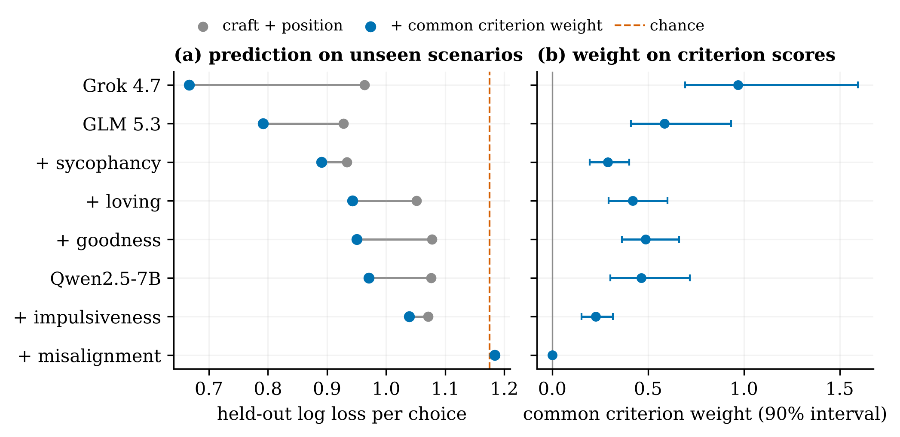
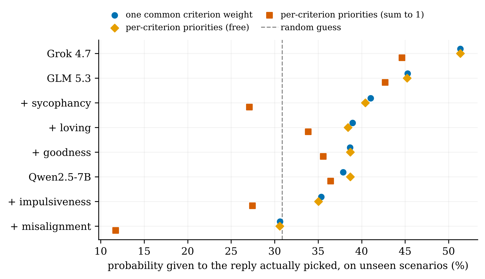
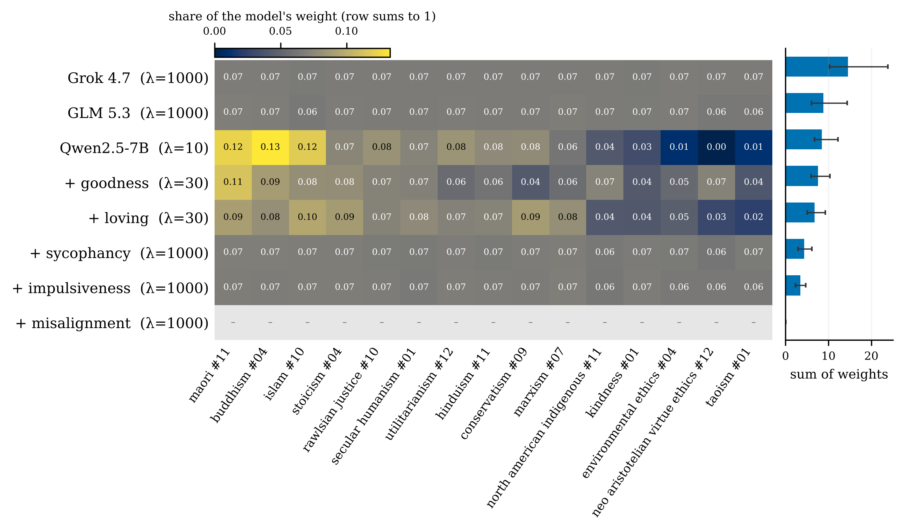
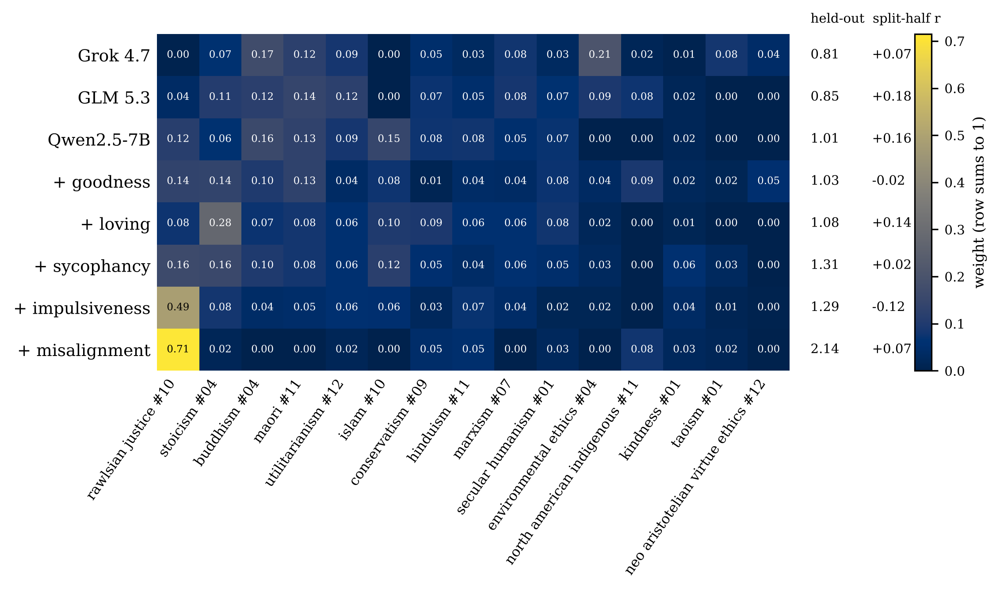

# 2.2 pilot: criterion weights from choices

A first run of the [constraint-recovery design](../README.md): 15 criteria, 45 scenarios, 8 target models. Each target
picks among fixed responses to each scenario, a judge scores those responses on the criteria, and a choice model fits
one weight per criterion from the picks, tested on unseen scenarios.

**Result in one line:** a single common weight on the criterion scores predicts the targets' picks on unseen scenarios,
but per-criterion priorities are not recovered: they predict no better than the common weight and do not replicate
across halves of the scenarios. Details in [Results](#results).

## Pipeline

| Step | Script | What it does | Output |
|---|---|---|---|
| 1 Criteria | `select_criteria.py` | 15 of the 78 shortlisted criteria: embed the texts (`text-embedding-3-small`), farthest-point selection, at most one per tradition, starting from the criterion farthest from the mean (a seeded random start gave only ~40% overlap between seeds) | `criteria_pilot.jsonl`, `constitution.json` |
| 2 Scenarios | `run_scenarios.py` | Runs the scenario pipeline (`Constitutional-Evals/constitutions`, `mass_scenario_gen`) unchanged except: held-out judge GPT-5.6 Terra (Grok is a target), at least 6 scenarios per criterion, one top-up round | `scenarios.jsonl` (text, verified criteria, plausible actions) |
| 3 Responses | `make_responses.py` | One reply per plausible action, written in a random neutral style; natural answers from three models kept only if they propose a new course; a labeller checks each reply's action and flags value language (one rewrite by another writer) | `responses.jsonl` |
| 4 Ratings | `rate_responses.py` | EigenBench direct-rating prompts (reflection, then 1-10 per criterion) on each scenario's verified criteria; main judge twice, second judge once; a check for replies clearly better written than the others | `scores.jsonl`, `leading.jsonl` |
| 5 Choices | `collect_choices.py` (API), `personas_vllm.py` + `persona_pod.py` (GPU), `label_free.py` | Each target sees the scenario and its replies under 6 orderings × 3 samples and answers with a letter; also 3 free answers per scenario, labelled by action | `choices.jsonl`, `free_answers.jsonl` |
| 6 Fit | `fit_weights.py` | Conditional logit (below), 5-fold held-out log loss by scenario, bootstrap intervals | `fit_*.json` |
| Figures | `figures/gen_fig_*.py` | The charts below, from the published runs | `figures/*.png` |

`prepare_jash.py` converts Jash's criterion-groups snapshot (36 criteria, 47 scenarios) into the same inputs; that run
was stopped at step 3.

### Fit

For each pick, every reply $r$ shown gets $u(r) = \sum_c w_c\, z(r,c) + \text{craft} + \text{position}$, where $z$ is the
judge's score centred within the scenario and scaled per criterion; the pick probability is the softmax over the replies
shown. Craft covariates (the reply's writer, and whether it was flagged as clearly better written) and letter-position
bias have free coefficients. Variants compared on held-out log loss:

| Variant | Criterion part |
|---|---|
| uniform | none |
| craft + position | none |
| common weight | one weight shared by all criteria |
| additive (free) | $w_c \geq 0$ per criterion, penalty $\lambda \sum_c (w_c - \bar w)^2$ toward the common weight, $\lambda$ chosen by cross-validation inside the training folds |
| sum to 1 (the design doc's form) | $w$ on the simplex, $\beta = 10$ fixed |
| mixture | each pick follows one criterion $c$ with probability $\pi_c$ |

Optimiser: L-BFGS-B with an analytic gradient. Evaluation: 5-fold cross-validation by scenario (all orderings and
samples of a scenario in the same fold). Intervals: bootstrap over scenarios.

## Setup and run

```bash
cd 2.2-fit-rulebook-from-clauses/pilot
python -m venv .venv && source .venv/bin/activate
pip install -r requirements.txt
export OPENROUTER_API_KEY=...       # every model call (generation, judging, API targets)
export HF_TOKEN=... RUNPOD_API_KEY=...   # only for the persona models on a GPU pod

S=artifacts
PYTHONPATH=scripts python scripts/select_criteria.py criteria_78.csv --n 15 --out $S/step1
PYTHONPATH=scripts python scripts/run_scenarios.py --pipeline "<constitutions clone>/mass_scenario_gen/mass_scenario_generation_pipeline_10_24_26 (1).py" \
    --constitution $S/step1/constitution.json --run-id scenarios-pilot15 --candidates 120 --topup 60 --min-per-criterion 6
SC=$S/runs/scenarios-pilot15/scenarios.jsonl
PYTHONPATH=scripts python scripts/make_responses.py --scenarios $SC --out $S/step3          # --writers <one model> to use a single writer
PYTHONPATH=scripts python scripts/rate_responses.py --scenarios $SC --responses $S/step3/responses.jsonl \
    --criteria $S/step1/criteria_pilot.jsonl --out $S/step4
PYTHONPATH=scripts python scripts/collect_choices.py --model x-ai/grok-4.7 --scenarios $SC \
    --responses $S/step3/responses.jsonl --out $S/step5/grok-4.7
PYTHONPATH=scripts python scripts/persona_pod.py launch --pod-run personas-pod --hf-repo <user>/<dataset> \
    --hf-folder pods/personas-pod --scenarios $SC --responses $S/step3/responses.jsonl   # then label_free.py on its outputs
PYTHONPATH=scripts python scripts/fit_weights.py --scores $S/step4/scores.jsonl --criteria $S/step1/criteria_pilot.jsonl \
    --choices $S/step5/*/choices.jsonl --responses $S/step3/responses.jsonl --leading $S/step4/leading.jsonl --out $S/step6/fit.json
```

Every API reply is cached by content, so an interrupted step resumes without paying again. The pilot's inputs and
outputs are public on Hugging Face ([`invi-bhagyesh/log`, `constitution-recovery/`](https://huggingface.co/datasets/invi-bhagyesh/log/tree/main/constitution-recovery)):
runs `20261106-criteria-pilot15`, `-scenarios-pilot15-v2`, `-responses-pilot15`, `-ratings-pilot15`,
`-choices-pilot15`, `-fit-pilot15`. The figure scripts read from there: `PYTHONPATH=scripts python figures/gen_fig_pilot_fit.py`.

## Models

| Role | Models |
|---|---|
| Scenario generation | the pipeline's development models (Kimi, Qwen, Gemini); held-out judge GPT-5.6 Terra |
| Response writers | GPT-5.6 Terra, Gemini 3.8 Flash; natural answers from GPT-5.6 Luna, Gemini 3.8 Flash, Kimi |
| Judges | Claude Sonnet 5.5 (main, 2 samples), Qwen 3.8 Max (second) |
| Targets | Grok 4.7, GLM 5.3 (API, default reasoning); Qwen2.5-7B-Instruct and its Open Character Training adapters goodness, loving, sycophancy, impulsiveness, misalignment (vLLM, temperature 0.7) |

## Results

45 scenarios, 3-4 replies each (149), 810 picks per target (all parsed). Total cost about $53 (API) plus $0.25 of GPU.



**Models follow the criteria overall.** One common weight predicts picks on unseen scenarios beyond craft and position
for every target but the misalignment persona, whose picks are at chance. As probability given to the reply actually
picked: Grok 51%, GLM 45%, the Qwen variants 35-41%, random 31%.



**Per-criterion priorities are not recovered.** Free per-criterion weights predict unseen picks no better than the
common weight; weights constrained to sum to 1 (β = 10) predict worse for every target, below random for three.
Rankings fitted on two random halves of the scenarios are unrelated (Spearman about 0 for every target, 50 splits):





**Weighted trade-off over one criterion per choice:** the mixture rule fits worse than the additive one for every target.

### Why priorities were not recovered

- **Few conflicts.** 23 of 45 scenarios test a single criterion; only 9 put two criteria on different replies; no pair of
  criteria conflicts in more than two scenarios. A priority is only identifiable from such conflicts.
- **Judge halo.** Within a scenario, the judge's scores for two criteria correlate at a median +0.76 across the replies:
  the 15 criterion features behave like one "good reply" axis.
- **Craft.** Targets prefer the reply flagged as better written, and the two writers differ in quality (24 of 25 flagged
  replies by GPT-5.6 Terra, tied to action position); controlled in the fit only by covariates.
- **What is measured.** "Which reply would you send?" is itself a judging task, so the common weight may partly be
  agreement with the judge's taste rather than following the criteria.

### Next

- Fewer criteria (4-6), chosen to conflict, with every pair put in conflict in several scenarios.
- Replies built so each satisfies one side of a conflict, so a pick is a direct pairwise comparison (Bradley-Terry over
  criteria) without judge scores; otherwise one criterion per judge call.
- Validation with LoRA adapters trained on a known priority order: if the fit cannot recover "A above B" from a model
  trained on it, the approach does not work.
